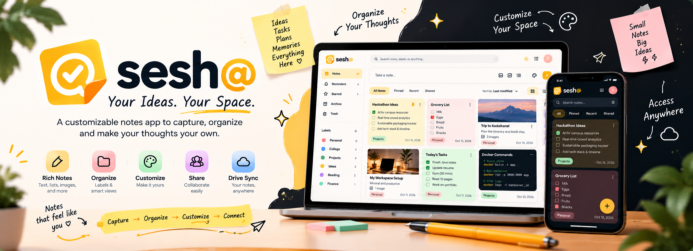

<div align="center">

  

  <br />
  <br />

  <h1>✦ Sesh@ ✦</h1>
  <p><strong>A Highly Customizable, Google Drive-Powered Collaborative Notes Workspace</strong></p>

  <p>
    <em>Inspired by the instant usability of Google Keep, elevated with deep visual personalization, stylus drawing studios, live multi-user real-time collaboration, and 100% user-owned Google Drive storage.</em>
  </p>

  <p>
    <a href="#-quick-tour"></a>
    <a href="#-google-drive-sync"></a>
    <a href="#-real-time-collaboration"></a>
    <a href="#-tech-stack"></a>
    <a href="#-getting-started"></a>
  </p>

  <br />

  <table align="center">
    <tr>
      <td align="center"><b>📝 Rich Notes</b><br/>Text, checklists, markdown & code blocks</td>
      <td align="center"><b>🎨 Note Design Studio</b><br/>Per-note colors, gradients, fonts & borders</td>
      <td align="center"><b>✍️ Freehand Canvas</b><br/>Pressure-sensitive stylus, pens & highlighters</td>
      <td align="center"><b>👥 Live Share</b><br/>Collaborate via email with real-time sync</td>
      <td align="center"><b>☁️ 100% Drive Owned</b><br/>Zero proprietary lock-in; stored in your Drive</td>
    </tr>
  </table>

</div>

---

<details open>
<summary><h2>📑 Interactive Table of Contents</h2></summary>

- [✨ Why Sesh@?](#-why-sesh)
- [🎯 Interactive Feature Matrix](#-interactive-feature-matrix)
- [📖 Read-Friendly Distraction-Free Viewer](#-read-friendly-distraction-free-viewer)
- [🎨 The Note Design Studio & Smart Contrast Engine](#-the-note-design-studio--smart-contrast-engine)
- [📌 Flexible Layouts: Grid, List & Freeboard](#-flexible-layouts-grid-list--freeboard)
- [☁️ Google Drive-First & Offline Architecture](#️-google-drive-first--offline-architecture)
- [🔄 Real-Time Collaboration (Keep-Style)](#-real-time-collaboration-keep-style)
- [🛠️ Tech Stack & Ecosystem](#️-tech-stack--ecosystem)
- [🚀 Quickstart & Installation](#-quickstart--installation)
- [⚙️ Environment Configuration](#️-environment-configuration)
- [📱 Responsive Mobile & Desktop Layouts](#-responsive-mobile--desktop-layouts)
- [🤝 Contributing & Community](#-contributing--community)

</details>

---

## ✨ Why Sesh@?

Most note-taking applications lock your notes into closed databases or force you into generic, rigid black-and-white grids. 

**Sesh@** is designed around a simple philosophy: **Notes that feel like *you*.**

```
┌─────────────────────────────────────────────────────────────────────────────┐
│                                                                             │
│   Capture ───────► Organize ───────► Customize ───────► Connect & Share     │
│   (Markdown/Pen)   (Labels/Pins)     (Design Studio)    (Drive & Friends)   │
│                                                                             │
└─────────────────────────────────────────────────────────────────────────────┘
```

- **Zero Data Lock-in:** All your notes, checklists, image attachments, and canvas sketches sync directly into your personal **`Sesh@ Workspace`** folder in Google Drive.
- **Deep Personalization:** Every single note can have its own personality — custom pastel backgrounds, rich gradients, wallpaper textures, bespoke fonts (*Inter, Poppins, Caveat, Merriweather, Fira Code*), and adaptive contrast typography.
- **Instant Usability:** Feels as lightweight and effortless as Google Keep, with the power of a modern design system.

---

## 🎯 Interactive Feature Matrix

<details open>
<summary><b>Click to expand/collapse feature capabilities</b></summary>

| Capability | What Sesh@ Delivers | Why You Will Love It |
| :--- | :--- | :--- |
| **Google Drive v3 Sync** | Dual-persistence engine: IndexedDB local-first + Google Drive JSON hierarchy | Full ownership of your data with live quota meters and folder shortcut links |
| **Live Collaboration** | Frictionless sharing via friend's email with instant Firestore replication | Simultaneous editing with live presence badges and real-time keystroke propagation |
| **Note Design Studio** | Full visual customization suite with reusable theme presets | Create notes with solid pastels, gradient glows, custom images, and border curves |
| **Smart Contrast Engine** | ITU-R BT.601 luminance analysis with automatic inverted contrast | Never struggle to read dark text on dark notes or light text on pale backgrounds |
| **Read-Friendly Viewer** | Dedicated reading mode with text-to-speech read aloud, zen fullscreen & themes | Read notes like articles in *Paper White*, *Warm Sepia*, or *Night Parchment* |
| **Stylus & Pen Canvas** | Multi-tool drawing studio with grid/ruled paper backgrounds and PNG export | Sketch diagrams, handwrite formulas, or annotate ideas directly inside notes |
| **Interactive Checklists** | Interactive progress bar, draggable items, keyboard shortcuts (`Enter`/`Backspace`) | Track grocery lists, sprint items, and milestones with instant completion analytics |
| **Code Snippets** | Syntax-highlighted code editor with language selector and one-click copy | Store Python, TypeScript, Bash, Rust, SQL, and HTML snippets cleanly |
| **Organic Freeboard** | Google Keep-style freeform board where notes sit in organic positions | Scatter, drag, and freely move cards across an infinite movable canvas |

</details>

---

## 📖 Read-Friendly Distraction-Free Viewer

When you open any note in Sesh@, it opens directly in a **distraction-free reader view** inspired by editorial publications:

<div align="center">
  <table>
    <tr>
      <td width="33%" align="center"><b>📄 Paper White</b><br/>Crisp neutral contrast for bright daylight reading</td>
      <td width="33%" align="center"><b>📜 Warm Sepia</b><br/>Gentle warm book-paper palette that eases eye strain</td>
      <td width="33%" align="center"><b>🌙 Night Parchment</b><br/>Deep matte dark mode for late-night review</td>
    </tr>
  </table>
</div>

- **Dynamic Typography Scaling:** Toggle font sizes (`14px` Small · `17px` Default · `19px` Large · `22px` Extra Large).
- **Text-to-Speech (TTS):** Hit the **Read Aloud** button (`Volume2`) to listen to your notes hands-free.
- **Reading Analytics:** Real-time word count and estimated reading time computation.
- **Markdown & Interactive Elements:** Headings, blockquotes, code blocks, checklists, and sketches render as high-fidelity interactive elements.
- **Seamless Edit Transition:** Double-click anywhere or press **"Edit Note"** to jump seamlessly into the markdown editor.

---

## 🎨 The Note Design Studio & Smart Contrast Engine

Sesh@ features a **per-note visual design engine**:

```
Note Appearance
 ├── Background: Solid (#FEF3C7) | Multi-stop Gradient | Custom Uploaded Cover Image
 ├── Typography: Inter (Default) | Poppins | Caveat (Handwritten) | Merriweather (Serif) | Fira Code (Mono)
 ├── Geometry: Border Radius (6px to 24px) | Border Width | Border Style (Solid/Dashed/Dotted)
 └── Elevation: Soft ambient drop shadows and colored glowing borders
```

### 🧠 The Mathematical Contrast Guarantee

> *"If a user customizes their font color, let it be. If the user hasn't chosen a font color, automatically give it a negative color of its background."*

Sesh@ implements an automated perceptual luminance engine using the **ITU-R BT.601 perceived brightness algorithm**:

$$Y = 0.299 \times R + 0.587 \times G + 0.114 \times B$$

- If background luminance $Y > 180$, text automatically defaults to ultra-crisp negative dark tones (`#0F172A`).
- If background luminance $Y < 120$, text shifts to vivid light tones (`#F8FAFC`).
- For custom gradients or uploaded background photos, an adaptive translucent backdrop scrim ensures **WCAG AA compliant contrast** at all times.

---

## 📌 Flexible Layouts: Grid, List & Freeboard

Switch effortlessly between three distinct workspace perspectives:

<div align="center">

```
  ┌─────────────────┐       ┌─────────────────┐       ┌─────────────────┐
  │   [ 1 ] [ 2 ]   │       │   [ Note 1 ]    │       │    [ 1 ]  \     │
  │   [ 3 ] [ 4 ]   │  vs   │   [ Note 2 ]    │  vs   │  /       [ 2 ]  │
  │   [ 5 ] [ 6 ]   │       │   [ Note 3 ]    │       │     [ 3 ]       │
  └─────────────────┘       └─────────────────┘       └─────────────────┘
     Responsive Grid            Single List             Movable Freeboard
   (Drag-to-Reorder)         (Executive View)         (Scatter & Random)
```

</div>

1. **Responsive Horizontal Grid (Keep-Style):** Notes naturally flow row-by-row across columns with drag-and-drop reordering. Separate **PINNED** and **OTHERS** sections keep your top priorities anchored.
2. **Executive List View:** A clean single-column feed ideal for reading long-form drafts, minutes of meetings, and detailed journals.
3. **Movable Freeboard / Random Spots:** Drag and place cards anywhere on an organic canvas with natural tilt angles. Includes **"Scatter Spots"** and **"Tidy Board"** quick-actions.

---

## ☁️ Google Drive-First & Offline Architecture

```
User's Google Drive Root
└── 📁 Sesh@ Workspace/
    ├── 📄 workspace-index.json         <-- Workspace metadata, labels, appearance presets
    ├── 📁 notes/
    │   ├── 📄 note_1729000000000.json  <-- Complete note object (title, items, drawings)
    │   └── 📄 note_1729000000001.json
    └── 📁 attachments/                 <-- High-resolution image uploads & canvas exports
```

### ⚡ Local-First, Instant UI
- **IndexedDB Write-Through Cache:** Changes commit locally in `<10ms` for seamless offline writing.
- **Debounced Cloud Sync:** Batches and uploads operational deltas to Google Drive without hitting API rate limits.
- **Accurate Quota Telemetry:** Direct Drive v3 API queries display exact used bytes and storage breakdown.

---

## 🔄 Real-Time Collaboration (Keep-Style)

Share notes with friends and teammates using just their **email address**:

1. **One-Click Share:** Enter your friend's email (`user@domain.com`) and choose **Editor** or **Viewer** role.
2. **Real-Time Replication:** Uses Cloud Firestore mutation streams to replicate title edits, checklist toggles, drawings, and styling changes across all active sessions instantly.
3. **Smart Re-Sync:** Reconnects automatically if internet is temporarily lost, resolving concurrent edits via **Last-Write-Wins (LWW)** and timestamp reconciliation.
4. **Instant Import Backup:** Also generates encrypted self-contained share URLs for friends who prefer offline link import.

---

## 🛠️ Tech Stack & Ecosystem

<div align="center">

| Layer | Technologies |
| :--- | :--- |
| **Frontend Framework** | [React 19](https://react.dev/) + [TypeScript](https://www.typescriptlang.org/) |
| **Build & Tooling** | [Vite 8](https://vitejs.dev/) with ultra-fast ESModule HMR |
| **Styling & Design** | [Tailwind CSS v4](https://tailwindcss.com/) with native CSS variable color tokens |
| **Icons & Visuals** | [Lucide React](https://lucide.dev/) (consistent, crisp stroke icons) |
| **Cloud Storage** | [Google Drive API v3](https://developers.google.com/drive) (Client-side OAuth 2.0 PKCE) |
| **Real-Time Sync** | [Google Cloud Firestore](https://firebase.google.com/docs/firestore) (Downstream snapshots) |
| **Local Cache** | HTML5 [IndexedDB](https://developer.mozilla.org/en-US/docs/Web/API/IndexedDB_API) storage engine |
| **Audio Engine** | Web Speech API (`SpeechSynthesis`) for zero-dependency Text-to-Speech |

</div>

---

## 🚀 Quickstart & Installation

### Prerequisites
- [Node.js](https://nodejs.org/) (v18.0.0 or higher recommended)
- `npm` or `pnpm` or `yarn`

### 1. Clone the repository
```bash
git clone https://github.com/your-username/sesh-notes.git
cd sesh-notes
```

### 2. Install dependencies
```bash
npm install
```

### 3. Start the development server
```bash
npm run dev
```

Visit `http://localhost:3000` in your browser. Sesh@ will be running with full offline IndexedDB and guest mode capabilities immediately!

---

## ⚙️ Environment Configuration

To enable **Google Drive Sync** and **Cloud Collaboration**, create a `.env` file in the root directory:

```env
# Google OAuth Client (Google Cloud Console -> APIs & Services -> Credentials)
VITE_GOOGLE_CLIENT_ID=your_google_client_id.apps.googleusercontent.com
VITE_GOOGLE_API_KEY=your_google_api_key

# Firebase Configuration (Firebase Console -> Project Settings)
VITE_FIREBASE_API_KEY=your_firebase_api_key
VITE_FIREBASE_AUTH_DOMAIN=your_project.firebaseapp.com
VITE_FIREBASE_PROJECT_ID=your_project_id
VITE_FIREBASE_STORAGE_BUCKET=your_project.appspot.com
VITE_FIREBASE_MESSAGING_SENDER_ID=your_sender_id
VITE_FIREBASE_APP_ID=your_app_id
```

> **Note:** If Google credentials are not supplied, Sesh@ automatically switches to **Full Offline / Guest Mode**, saving all data directly inside browser IndexedDB.

---

## 📱 Responsive Mobile & Desktop Layouts

Sesh@ is built with a **dual-layout philosophy**:

- **Desktop (PC / Mac):** Expansive multi-column responsive workspace, collapsible sidebar navigation, quick keyboard shortcuts, and floating design toolbars.
- **Mobile Web (iOS / Android):** Native-feeling bottom navigation bar, thumb-accessible floating action button (FAB) for instant note creation, safe-area inset padding, and full touch-drag gestures.

---

## 🎨 Official Brand Palette

| Color Name | Hex Code | Visual Preview | Purpose |
| :--- | :--- | :---: | :--- |
| **Sesh Yellow** | `#FFBF24` | `■` | Primary brand accent, active tabs, buttons |
| **Amber Glow** | `#F59E0B` | `■` | Interactive hover highlights, pinned indicators |
| **Ivory Surface** | `#FFFBF2` | `■` | Warm, calming light mode canvas background |
| **Midnight** | `#0B111E` | `■` | Deep dark mode workspace surface |
| **Emerald Sage** | `#10B981` | `■` | Live synchronization indicators and tags |
| **Rose Peach** | `#F87171` | `■` | Urgent reminders, critical labels, alerts |

---

## 🤝 Contributing & Community

Contributions are what make the open-source community such an amazing place to learn, inspire, and create! Any contributions you make are **greatly appreciated**.

1. Fork the Project
2. Create your Feature Branch (`git checkout -b feature/AmazingFeature`)
3. Commit your Changes (`git commit -m 'Add some AmazingFeature'`)
4. Push to the Branch (`git push origin feature/AmazingFeature`)
5. Open a Pull Request

---

<div align="center">

  <p><strong>Sesh@ — Your Ideas. Your Space.</strong></p>
  <p><em>Organize your thoughts. Customize your space. Access anywhere.</em></p>

  <sub>Crafted with ❤️ for thinkers, builders, students, and dreamers.</sub>

</div>
